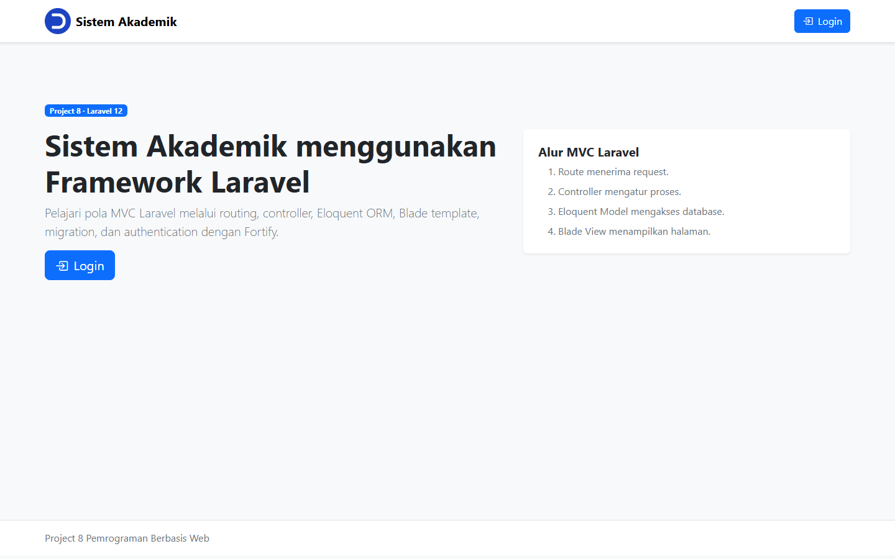
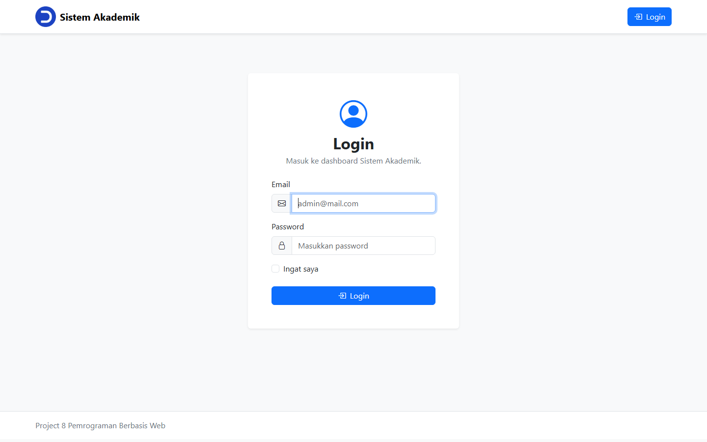
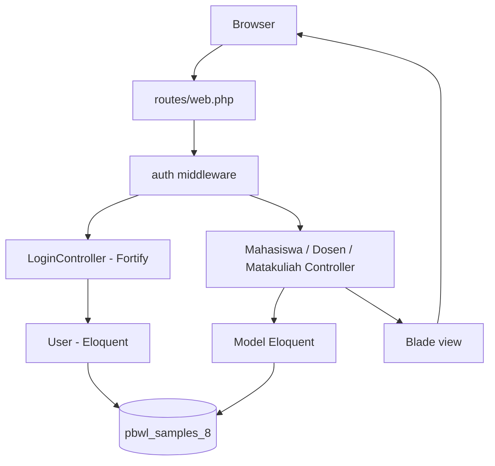

<div align="center">

# ⚡ Sistem Akademik Project 8

**Project 8 · Laravel 12 + Fortify**

Sistem Akademik dalam **Laravel 12** dengan autentikasi **Fortify** (login, 2FA, passkey), Eloquent, migration, dan Blade.

     

</div>

## 📖 Deskripsi

Ini adalah versi framework dari project sebelumnya. Routing memakai `routes/web.php`, data diakses lewat Eloquent (`Mahasiswa`, `Dosen`, `Matakuliah`, `User`), migrasi sudah termasuk tabel two-factor dan passkey. Fortify menangani login, reset password, konfirmasi password, 2FA, dan passkey.

## 📸 Tampilan

<table>
 <tr>
 <td width="50%"><br><sub>Halaman Awal</sub></td>
 <td width="50%"><br><sub>Login Fortify</sub></td>
 </tr>
</table>

## ✨ Fitur

- ⚡ Laravel 12 + Eloquent ORM
- 🔐 Fortify: login, logout, reset & konfirmasi password
- 🔑 Two-factor authentication & **passkey**
- 📋 Resource Mahasiswa, Dosen, Matakuliah
- 🧬 Migration & factory (termasuk `add_two_factor_columns`, `create_passkeys`)
- 🎨 Blade template + Vite
- 🛡️ Middleware `auth` untuk dashboard & modul

## 🧱 Teknologi

| Lapisan | Teknologi |
| --- | --- |
| Framework | Laravel 12 |
| Auth | Laravel Fortify (2FA + passkey) |
| PHP | 8.2+ (dijalankan dengan PHP 8.3) |
| Database | MySQL `pbwl_samples_8` port 3307 |
| View | Blade + Vite |
| Testing | PHPUnit |

## 🏗️ Arsitektur



## 🚀 Instalasi

1. Pastikan PHP **8.2+** (XAMPP Anda punya PHP 8.3 di `D:\XAMPP\php83`).
2. Database `pbwl_samples_8` sudah dibuat; jalankan migrasi: `php artisan migrate --force`.
3. **Apache di mesin ini masih PHP 8.0**, jadi jalankan lewat server bawaan Laravel:

 ```bash
 cd D:\XAMPP\htdocs\project8
 D:\XAMPP\php83\php.exe artisan serve --host=127.0.0.1 --port=8000
 ```

4. Buka **http://127.0.0.1:8000/**.

> `vendor/` sudah disertakan. Jika autoload perlu diperbarui:
> `php83 composer.phar dump-autoload --ignore-platform-req=php`

## 🗂️ Struktur

```
project8/
├── app/
│ ├── Actions/Fortify/ # 5 action Fortify
│ ├── Http/Controllers/ # Dashboard, Mahasiswa, Dosen, Matakuliah
│ ├── Models/ # User, Mahasiswa, ...
│ └── Providers/FortifyServiceProvider.php
├── bootstrap/
├── config/ # fortify.php, auth.php, database.php
├── database/
│ ├── migrations/ # users, cache, jobs, 2FA, passkeys, mahasiswa
│ ├── factories/
│ └── seeders/
├── public/ # index.php (document root)
├── resources/views/ # Blade
├── routes/
├── storage/
├── tests/
├── .env
├── artisan
└── README.md
```

## 🗄️ Database

Database **`pbwl_samples_8`** di MySQL/MariaDB port **3307** (user `root`, password kosong).

File `database.sql` sudah diimpor. Jika perlu import ulang:

```bash
mysql -h 127.0.0.1 -P 3307 -u root pbwl_samples_8 < database.sql
```

> Database lain di XAMPP (termasuk `dbakademik`) sengaja tidak disentuh.

## ✅ Verifikasi

- `http://127.0.0.1:8000/` → 200
- `/login` → 200
- `/dashboard`, `/mahasiswa`, `/dosen`, `/matakuliah` → butuh login
- 6 migrasi berhasil dijalankan

## 🔗 Tautan

- GitHub: https://github.com/Neuron700/project-pbwl-8
- Aplikasi: http://127.0.0.1:8000/ (artisan serve, PHP 8.3)

## 📄 Lisensi

MIT
